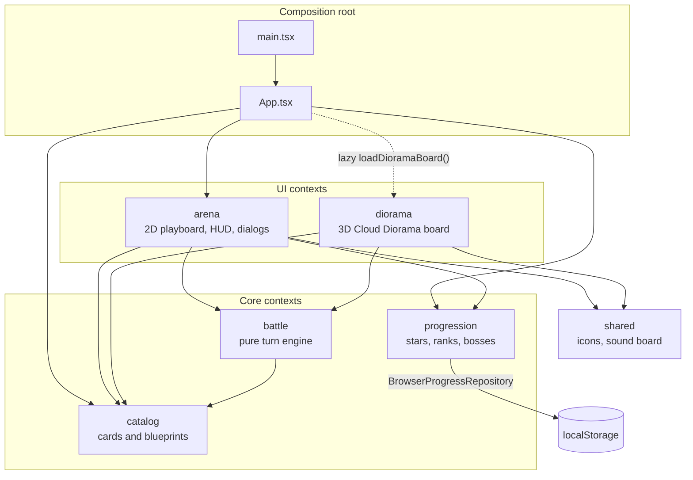
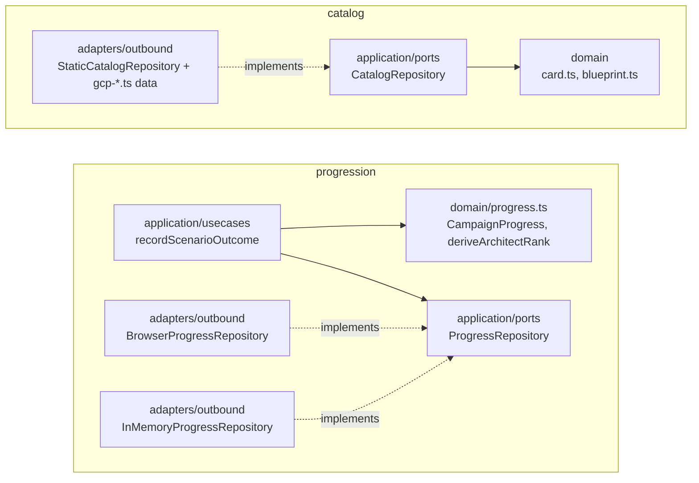
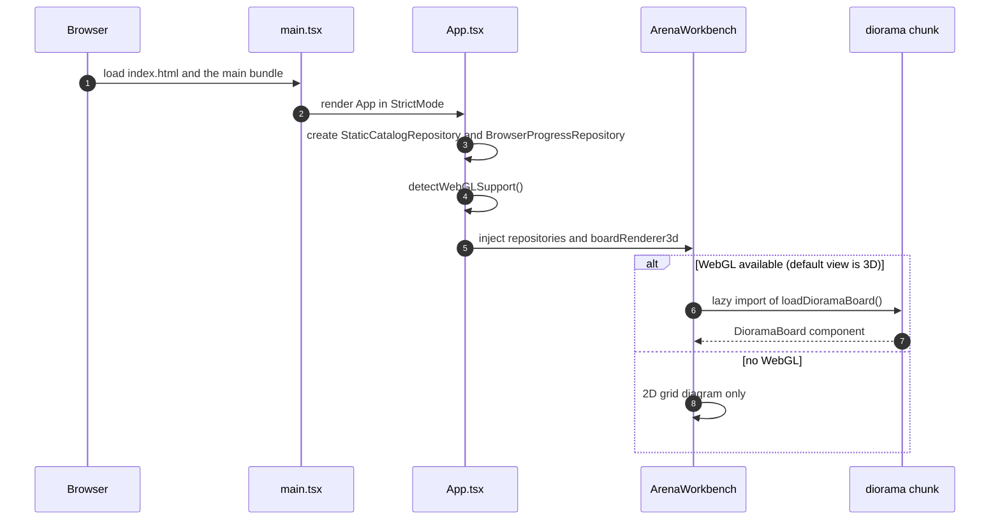
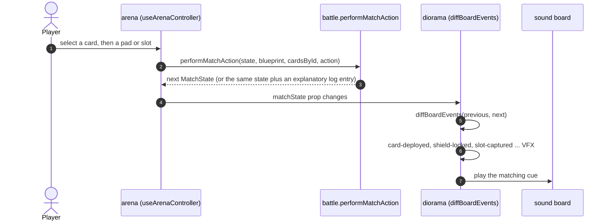
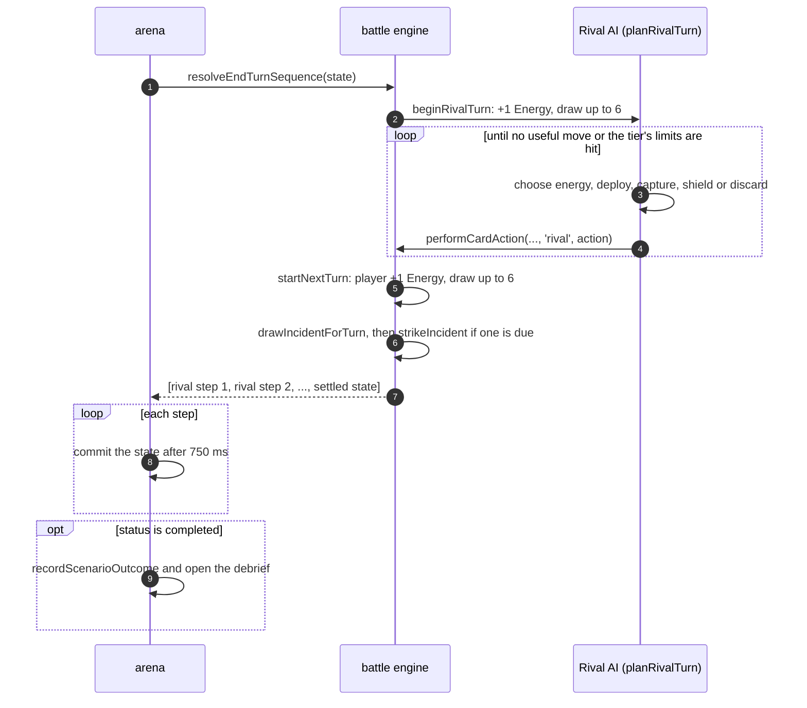

# Architecture

GCP Card Clash is a **client-only single-page app**: React 19, TypeScript and Vite, with a lazily loaded React Three Fiber board. There is no backend. The curriculum ships in the bundle, and campaign progress lives in the browser's `localStorage`.

The code is organised as five **bounded contexts** under `src/modules/`, each with a public `index.ts` facade. The authoritative registry is [`architecture/CONTEXT_MAP.md`](architecture/CONTEXT_MAP.md), and the decisions behind it are the [ADRs](adr/README.md).

## Context map

Arrows mean "imports the public facade of". Dependencies only point inward, and `arena` never imports `diorama`: the composition root injects the 3D board into it.



| Context | Owns | Layers |
|---|---|---|
| `catalog` | 41 cards, 19 blueprints across 5 tracks, the grid diagram model and lane router, official doc references | `domain` → `application/ports` → `adapters/outbound` |
| `battle` | The deterministic match engine: decks, energy, placement, shields, captures, incidents, Rival AI, scoring | `domain` → `application/usecases` |
| `progression` | Best stars and score per blueprint, boss defeats, Architect Rank | `domain` → `application/ports` → `adapters/outbound` |
| `arena` | The React UI: header, diagram, hand dock, inspector, dialogs, immersive HUD, end-turn playback | `presentation` |
| `diorama` | The 3D board: island layout, camera fit, state-to-event diffing, models, VFX, post-processing | `domain` (pure) + `presentation` (R3F) |

## Hexagonal rings

`catalog` and `progression` are full ports-and-adapters contexts. The domain has zero framework imports, the application layer talks to the outside only through a port, and adapters implement that port.



The in-memory adapter is what the tests use, so no test touches real browser storage.

## Boot sequence

The Three.js chunk is about 1.25 MB minified, so it is only fetched when the browser can draw it.



## One player action

Every move goes through the pure engine and comes back as a new immutable `MatchState`. The 3D board never reads the engine's rules: it diffs the previous and next state into **board events** and animates those.



## End of turn

`resolveEndTurnSequence` returns **every intermediate state**: one per Rival action, then the start of the next turn. The UI commits them one at a time, 750 ms apart, so the Rival's turn plays out like a real opponent.



## Source layout

```text
src/
├── main.tsx, App.tsx          # entry point and composition root
├── modules/
│   ├── catalog/               # domain · application/ports · adapters/outbound
│   ├── battle/                # domain · application/usecases
│   ├── progression/           # domain · application/ports · adapters/outbound
│   ├── arena/                 # presentation (React UI)
│   └── diorama/               # domain (pure) · presentation (R3F)
├── shared/                    # gcp-icons.tsx, audio/sound-board.ts
└── styles/                    # global CSS by surface
tests/modules/<context>/       # mirrors src/modules 1:1
public/audio, public/models    # CC0 sounds and Kenney glTF models
```

## Rules that keep it maintainable

- Import other contexts only through their `index.ts`, never a private file.
- Keep `domain/` free of React, Three.js and browser APIs, so it is tested without mocks.
- Record boundary changes as an ADR in [`adr/`](adr/README.md) and update the context map in the same change.
- Every card and blueprint cites official Google Cloud docs. `tests/modules/catalog/references.test.ts` enforces this (ADR-0010).
