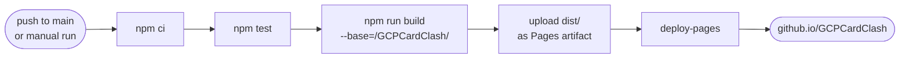

# Deployment

GCP Card Clash is a static site: `npm run build` produces a `dist/` folder of HTML, JS, audio and glTF models with no server, database or secrets. It deploys to **GitHub Pages** through [`.github/workflows/deploy-pages.yml`](../.github/workflows/deploy-pages.yml) (ADR-0011).

Live URL once enabled: `https://joshuansu0897.github.io/GCPCardClash/`

## Pipeline



A failing test stops the run before anything is published. `npm run build` runs `tsc -b` first, so a type error does too.

## One-time setup

1. **Make Pages available.** GitHub Pages on a private repository needs GitHub Pro, Team or Enterprise. On a free account, make the repository public (*Settings → General → Danger Zone → Change visibility*).
2. **Pick the source.** *Settings → Pages → Build and deployment → Source:* **GitHub Actions**.
3. **Run it.** Push to `main`, or open *Actions → Deploy to GitHub Pages → Run workflow*.
4. **Check it.** The run's `deploy` job links the live URL. Load a blueprint, switch to 3D and play a card to confirm models and sounds load.

## Why the base path matters

A project site is served from `/GCPCardClash/`, not from `/`. The workflow passes that prefix to Vite with `--base`, which rewrites every script and stylesheet URL. Runtime assets already build their URLs from `import.meta.env.BASE_URL`:

| Asset | Built in |
|---|---|
| Kenney glTF models (`public/models`) | `src/modules/diorama/presentation/kit-models.tsx` |
| Sound effects (`public/audio`) | `src/shared/audio/sound-board.ts` |

Any new file under `public/` must do the same. A hard-coded `/models/...` works in `npm run dev` and breaks on Pages.

The app has no client-side router, so there is no deep-link 404 to work around.

## Preview the Pages build locally

```bash
npm run build -- --base=/GCPCardClash/
npx vite preview --base=/GCPCardClash/
# open http://localhost:4173/GCPCardClash/
```

On Windows **Git Bash**, prefix both commands with `MSYS_NO_PATHCONV=1`. Otherwise MSYS rewrites `/GCPCardClash/` into `C:/Program Files/Git/GCPCardClash/` and the page loads blank. PowerShell and the Linux CI runner are not affected.

## Troubleshooting

| Symptom | Cause | Fix |
|---|---|---|
| Workflow fails at "Configure GitHub Pages" | Pages source is not set to GitHub Actions, or the repo is private on a free plan | Do setup steps 1–2 |
| Page loads but is blank, with 404s for `/assets/...` | Built without `--base` | Use the workflow, or pass `--base=/GCPCardClash/` |
| Board renders but models or sounds are missing | An asset URL skips `import.meta.env.BASE_URL` | Prefix the path with `BASE_URL` |
| Progress is gone after moving to a new URL | `localStorage` is per origin | Expected: `localhost` and `github.io` keep separate progress |

## Other static hosts

`dist/` also works on Firebase Hosting or a Cloud Storage bucket. Build with `npm run build` (base `/`) when the site is served from a domain root.
