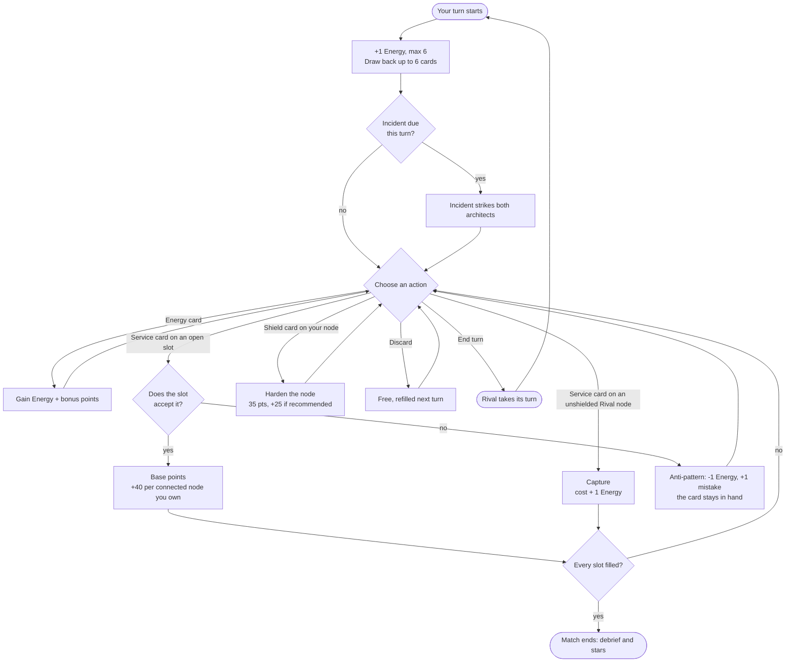
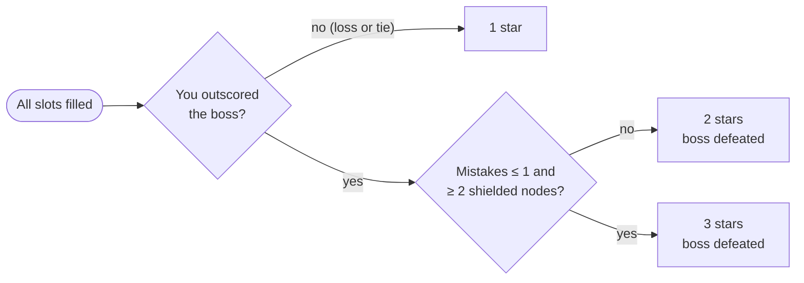

# Gameplay Rules

Each match is one Google Cloud reference architecture. You and the track's boss take turns filling the blueprint's slots with GCP services. The right service in the right slot scores; the wrong one teaches you why it is wrong. Every number below comes from `src/modules/battle/domain/`, and both architects play under the same rules (ADR-0004).

## Campaign

| Track | Boss | Signature incident |
|---|---|---|
| TRK-01 Cloud Foundations & Zero-Trust | The Monolith | Mainframe Change Freeze |
| TRK-02 Global & Hybrid Cloud Architect | Shadow Admin | Privilege Escalation |
| TRK-03 Serverless & Streaming Data | The Data Swamp | Schema Drift |
| TRK-04 Agent Platform & Enterprise GenAI | The Hallucinator | Prompt Injection Wave |
| TRK-05 Kubernetes & Platform Reliability | The YAML Golem | Config Drift |

There are 19 blueprints (`ARC-101` … `ARC-503`), each rated **Associate**, **Professional** or **Specialist**. Associate blueprints face a **gentle** boss; harder ones face a **sharp** boss (ADR-0007).

The deck holds 41 cards in three families:

| Family | Count | What it does |
|---|---|---|
| Provisioning Energy | 4 | Grants Energy (capped at 6) and a few bonus points |
| GCP Service | 32 | Deploys into a slot that accepts it |
| Security Shield | 5 | Hardens one of your nodes so it cannot be captured |

## A turn

Turn 1 starts with 2 Energy for each side. In **Guided Study** mode you always have full Energy, recommended answers are shown, there is no Rival or incidents, and a completed walkthrough earns 1 star.

## Scoring

| Event | Points |
|---|---|
| Deploy a valid service | The card's base points |
| Flow synergy | +40 for each diagram neighbour you already own |
| Capture a Rival node | +25 swing bonus; the Rival loses 35 |
| Attach any shield | +35 |
| Shield is the slot's recommended control | +25 more |
| Incident deploy bonus (e.g. Viral Traffic Surge) | As the incident says |
| Anti-pattern (wrong service) | 0 points, −1 Energy, +1 mistake |

Captures cost the card's Energy **+1**, and shielded nodes cannot be captured at all.

## Stars

The match ends the moment every slot is filled. The higher score wins.

## Cloud Incidents

Incidents strike at the start of a turn and affect **both** architects until the next turn begins.

| Boss tier | Strikes on |
|---|---|
| Gentle (Associate) | Turns 3, 6, 9 … |
| Sharp (Professional, Specialist) | Turns 2, 4, 6 … |

Strikes alternate: odd strikes draw from the general deck, even strikes play the boss's signature incident.

| Incident | Tone | Effect |
|---|---|---|
| Viral Traffic Surge | Boon | Deploying into an Edge zone scores +30 this turn |
| Startup Credits Approved | Boon | Both architects gain 1 Energy |
| Emergency Patch Window | Boon | Shields cost 0 Energy this turn |
| Zero-Day Disclosure | Hazard | Captures cost 1 less Energy this turn |
| Quarter-End Budget Freeze | Hazard | Both architects lose 1 Energy |
| Zonal Outage | Hazard | One zone's unshielded nodes return to open; owners lose 30 each |
| Surprise Compliance Audit | Twist | +20 per node with its optimal shield, −10 per unshielded node |
| Mainframe Change Freeze | Signature | Captures cost 1 more Energy this turn |
| Privilege Escalation | Signature | Every non-recommended shield is stripped |
| Schema Drift | Signature | Unshielded Data-zone nodes cost their owner 25 |
| Prompt Injection Wave | Signature | Unshielded AI-zone nodes go offline; owners lose 30 each |
| Config Drift | Signature | Unshielded nodes in one Compute zone crash-loop; owners lose 25 each |

The lesson in every hazard is the same: **shield early, and pick the recommended control**.

## The boss AI

The boss holds a real hand from its own deck and pays the same costs you do. Tiers change tactics, never rules.

| Tactic | Gentle | Sharp |
|---|---|---|
| Deploys per turn | 1 | up to 3 |
| Shields per turn | 1 | up to 2 |
| Captures from | Turn 3 | Turn 2 |
| Target choice | Next open slot in blueprint order | Highest-value slot |

## Architect Rank

Rank comes from total stars across the campaign (19 blueprints × 3 = 57).

| Total stars | Rank |
|---|---|
| 0–8 | Cloud Explorer |
| 9–23 | Associate Cloud Engineer |
| 24–41 | Professional Cloud Architect |
| 42+ | Principal Cloud Fellow |

Progress is saved in this browser only (`localStorage` key `gcp_card_clash_progress_v1`). Clearing site data resets it.
