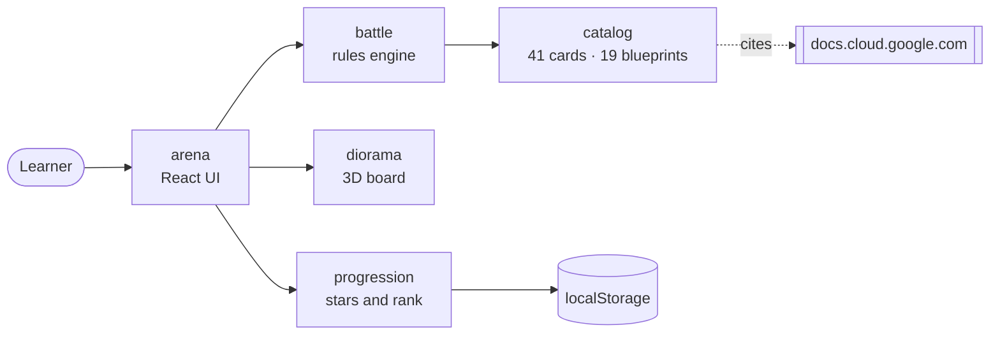

# GCP Card Clash Documentation

| Read this | To learn |
|---|---|
| [ARCHITECTURE.md](ARCHITECTURE.md) | How the five bounded contexts fit together, the hexagonal rings, and how a move flows from a click to the 3D board |
| [GAMEPLAY.md](GAMEPLAY.md) | Turn structure, scoring, stars, Cloud Incidents, boss tactics and Architect Rank |
| [DEPLOYMENT.md](DEPLOYMENT.md) | Publishing to GitHub Pages, the base-path rule, local preview and troubleshooting |
| [architecture/CONTEXT_MAP.md](architecture/CONTEXT_MAP.md) | The authoritative registry of contexts, facades, ports and governing ADRs |
| [adr/](adr/README.md) | Every architecture decision, with the options that were rejected |
| [catalog/fact-check-ledger.md](catalog/fact-check-ledger.md) | Each corrected curriculum claim, with its official source |

## Quick start

```bash
npm install
npm run dev        # http://localhost:5173
npm test           # Vitest suite
npm run typecheck  # strict TypeScript
npm run build      # static bundle in dist/
```

## Big picture



Everything runs in the browser. There is no backend, no account and no API key.

## License and disclaimer

Code is released under the [MIT License](../LICENSE). 3D models and sounds are by Kenney under CC0 ([credits](../public/models/CREDITS.md)).

GCP Card Clash is an independent, unofficial study game. It is not affiliated with, endorsed by or sponsored by Google LLC. Google Cloud, GCP and the product names in the game are trademarks of Google LLC, used only to describe the services being taught. Always check the official [Google Cloud documentation](https://docs.cloud.google.com/) before relying on a fact for production or an exam.
